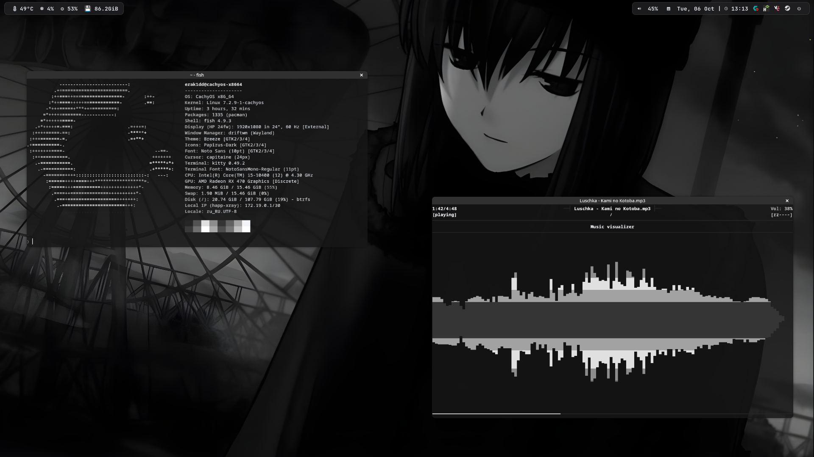

my first dotfiles

* composer: driftwm

* bar: waybar
* launcher: fuzzel
* terminal": kitty

* ncmpcpp/mpd

installation: 1) paste folders from repository to ~/.config/

2) bash 
chmod +x ~/.config/waybar/sys-exit.sh && chmod +x ~/.config/waybar/sys-reb.sh // (For poweroff/reboot button in Waybar)
